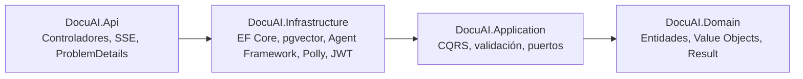
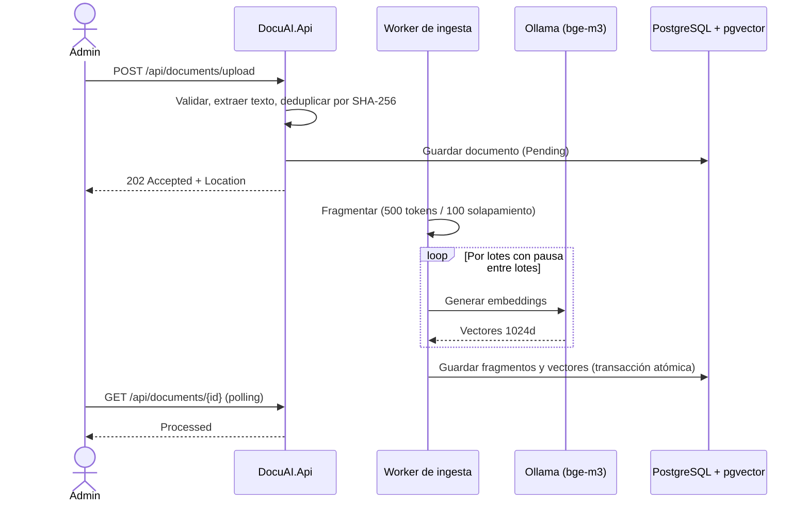
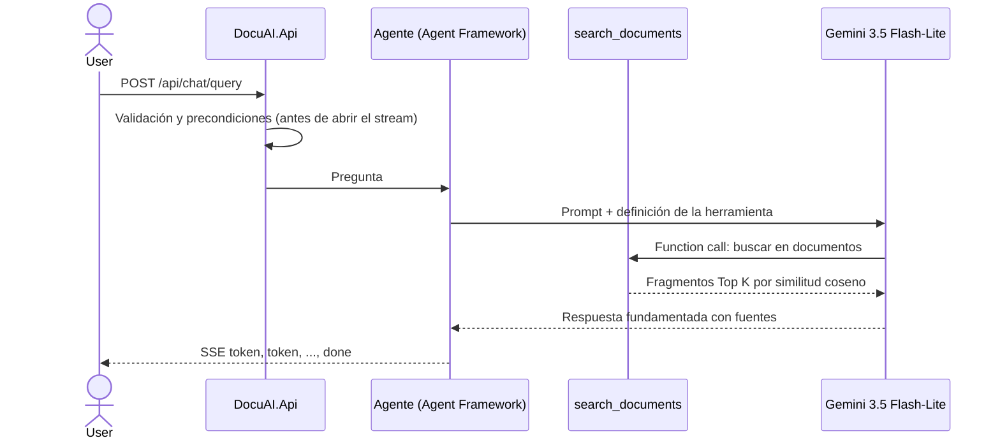

# DocuAI API

**Asistente de conocimiento corporativo con IA generativa: RAG multi-agente sobre .NET 10.**


DocuAI permite a una organización convertir sus documentos (PDF, TXT, Markdown) en una **base de conocimiento consultable en lenguaje natural**. Los administradores suben documentos; los usuarios preguntan y un **agente de IA responde únicamente con la información de esos documentos, citando las fuentes** y transmitiendo la respuesta palabra a palabra, como en ChatGPT.

> **En una frase:** una API de producción que combina IA generativa (LLM + agentes + búsqueda vectorial) con ingeniería de software empresarial (Clean Architecture, DDD, CQRS, resiliencia y seguridad por roles).

---

## Qué demuestra este proyecto

| Área | Evidencia en el código |
|---|---|
| **IA generativa aplicada** | Pipeline RAG completo de extremo a extremo: ingesta, fragmentación, embeddings, búsqueda vectorial y generación fundamentada |
| **Agentes de IA** | Agente construido con **Microsoft Agent Framework** (sucesor de Semantic Kernel y AutoGen) con herramientas propias invocadas por *function calling* |
| **LLM en producción** | Streaming por SSE, control de cuotas, reintentos ante 429, *circuit breaker*, proveedor intercambiable por configuración |
| **Arquitectura** | Clean Architecture en 4 capas, DDD, CQRS con MediatR, patrón Result sin excepciones de negocio |
| **Backend moderno** | .NET 10 y C# 14 (*primary constructors*, *required members*, *collection expressions*), EF Core, `IExceptionHandler`, ProblemDetails (RFC 9457) |
| **Seguridad** | JWT con roles estrictos, *rate limiting* por usuario e IP, mitigación de inyección de prompt indirecta, gestión de secretos |
| **Calidad** | Tests unitarios con xUnit, NSubstitute y Shouldly; versiones NuGet centralizadas; validación de configuración al arrancar |

---

## Skills de IA destacadas

### 1. Retrieval-Augmented Generation (RAG)
- **Fragmentación semántica** por frases y párrafos: bloques de 500 tokens con 100 de solapamiento, medidos con el tokenizador `o200k` para no partir ideas a mitad.
- **Generación de embeddings** con `bge-m3` (multilingüe, excelente en español, 1024 dimensiones), ejecutado **en local con Ollama**: coste cero y los documentos nunca salen de la infraestructura.
- **Búsqueda vectorial** en PostgreSQL con **pgvector**: índice **HNSW** con distancia **coseno**, recuperación *Top K* y **umbral de similitud** para descartar contexto irrelevante.
- **Respuestas fundamentadas**: el agente responde *solo* con lo que dicen los documentos y cita las fuentes; si no hay información, lo dice en lugar de inventar (mitigación de alucinaciones).

### 2. Agentes y *tool calling*
- Agente `ChatClientAgent` de **Microsoft Agent Framework** sobre `IChatClient` de **Microsoft.Extensions.AI** (abstracción estándar de .NET para LLMs).
- Herramienta `search_documents` expuesta al modelo con `AIFunctionFactory`: **el propio LLM decide cuándo y qué buscar** en la base vectorial.
- Dos estrategias de recuperación configurables:
  - `FunctionCalling`: el modelo orquesta la búsqueda, con un límite de iteraciones por pregunta.
  - `PreRetrieval`: la búsqueda se ejecuta siempre antes del modelo y el contexto se inyecta en el prompt. Útil para modelos pequeños o para minimizar peticiones.

### 3. Integración con LLMs en producción
- **Modelo final: `gemini-3.5-flash-lite`** (Google Gemini API), elegido por su latencia baja, su mayor cuota en el plan gratuito y su buen rendimiento en respuestas fundamentadas.
- **Agnóstico del proveedor**: se usa el endpoint compatible con OpenAI, de modo que cambiar a Groq, OpenRouter u Ollama local es solo cambiar configuración. El proyecto empezó con OpenRouter y migró a Gemini sin tocar la lógica de negocio.
- **Streaming token a token** mediante **Server-Sent Events** (`IAsyncEnumerable`), con eventos tipados `token`, `error` y `done`.
- **Gestión de cuotas de LLM**: *rate limiter* por usuario dimensionado frente al límite del proveedor (`preguntas/min × iteraciones del agente`).

### 4. Seguridad específica de IA
- **Defensa frente a inyección de prompt indirecta**: el prompt de sistema instruye al modelo a tratar los fragmentos recuperados como datos, nunca como instrucciones.
- Separación de privilegios: quien alimenta el RAG (`Admin`) no es necesariamente quien lo consulta (`User`).
- Embeddings locales para que el contenido indexado no se envíe a terceros.

---

## Stack tecnológico

| Capa | Tecnologías |
|---|---|
| Lenguaje y plataforma | C# 14, .NET 10, ASP.NET Core (controladores `ControllerBase`) |
| IA | Microsoft Agent Framework, Microsoft.Extensions.AI, Google Gemini API (`gemini-3.5-flash-lite`), Ollama (`bge-m3`) |
| Datos | PostgreSQL 17, pgvector (HNSW, coseno), Entity Framework Core |
| Aplicación | MediatR 12.5 (CQRS), FluentValidation, *pipeline behaviors* |
| Resiliencia | Polly v8 (`Microsoft.Extensions.Http.Resilience`), Rate Limiting de ASP.NET Core |
| Seguridad | JWT (HMAC-SHA256), autorización por roles, CORS estricto |
| Testing | xUnit, NSubstitute, Shouldly |
| Infraestructura | Docker Compose, health checks, OpenAPI |

---

## Arquitectura

Clean Architecture con dependencias dirigidas hacia el dominio:



```
src/
├── DocuAI.Domain          Entidades, Value Objects, Result/Error, puertos de repositorio (sin dependencias)
├── DocuAI.Application     CQRS con MediatR, FluentValidation, behaviors, puertos (IEmbeddingService, IChatAgent…)
├── DocuAI.Infrastructure  EF Core + pgvector, embeddings (Ollama), chat (Gemini) + Agent Framework, Polly v8, ingesta, JWT
└── DocuAI.Api             Controladores, mapeo Result → ProblemDetails, SSE, IExceptionHandler, CORS
tests/
└── DocuAI.UnitTests       xUnit + NSubstitute + Shouldly
```

### Flujo de ingesta (Admin)



La ingesta es **asíncrona y tolerante a reinicios**: un `BackgroundService` procesa los documentos de uno en uno, con cola acotada y máximo de intentos, y al arrancar reencola los que quedaron a medias.

### Flujo de chat (User)



---

## Decisiones técnicas destacadas

- **Embeddings locales y chat en la nube.** Los embeddings son el paso más intensivo en volumen (miles de fragmentos), así que se ejecutan en local sin coste ni cuotas. El chat, de menor volumen y que requiere más capacidad, usa Gemini.
- **Una sola capa de reintentos.** El SDK de OpenAI usa como transporte un `HttpClient` gestionado por Polly, con sus reintentos internos desactivados, para evitar reintentos multiplicados ante un 429.
- **Errores antes del stream.** Validación, base de conocimiento vacía (422) o límite de peticiones (429) se devuelven como HTTP convencional con ProblemDetails; solo se abre el stream SSE cuando la pregunta es procesable.
- **Patrón Result en lugar de excepciones.** La lógica de negocio devuelve `Result`/`Error`, que el controlador traduce a códigos HTTP. Las excepciones quedan reservadas a fallos de infraestructura, capturados por `GlobalExceptionHandler`.
- **Licencias bajo control.** MediatR fijado en 12.5.0, la última versión con licencia MIT.

---

## Resiliencia

| Capa | Mecanismo |
|---|---|
| Cliente de chat (Gemini) | Polly v8: timeout total, **reintentos exponenciales con jitter ante 429/5xx respetando `Retry-After`**, *circuit breaker* y timeout por intento |
| Cliente de embeddings (Ollama) | Pipeline propio con timeout amplio para la carga en frío del modelo |
| Ingesta | Lotes con pausas explícitas, cola acotada, procesamiento secuencial y máximo de intentos |
| API | *Rate limiting* por usuario en el chat y por IP en la emisión de tokens |
| Errores | Mapeo uniforme a ProblemDetails: 400 · 401 · 403 · 404 · 409 · 422 · 503 · 500 |

---

## API

| Método y ruta | Rol | Descripción |
|---|---|---|
| `POST /api/auth/token` | Anónimo | Emisor JWT de desarrollo |
| `POST /api/documents/upload` | Admin | Sube un documento (202 + `Location`) |
| `GET /api/documents` | Admin | Listado paginado con búsqueda, filtros por estado y fecha, y ordenación |
| `GET /api/documents/{id}` | Admin | Detalle y estado de la ingesta (polling) |
| `POST /api/documents/{id}/reprocess` | Admin | Reencola un documento fallido |
| `DELETE /api/documents/{id}` | Admin | Elimina el documento y sus vectores (cascada en BD) |
| `POST /api/chat/query` | User | Pregunta al agente; respuesta en streaming SSE |
| `GET /health/live`, `/health/ready` | Anónimo | Health checks (incluye disponibilidad del modelo de embeddings) |

Documento OpenAPI disponible en `/openapi/v1.json` (entorno Development).

---

## Puesta en marcha

**Requisitos:** SDK de .NET 10, Docker y una API key gratuita de [Google AI Studio](https://aistudio.google.com/apikey).

```bash
# 1. PostgreSQL + pgvector y Ollama (la primera vez descarga bge-m3, ~1,2 GB)
echo "POSTGRES_PASSWORD=<tu-password>" > .env
docker compose up -d
docker compose logs -f ollama-pull-model   # esperar a "success"

# 2. Secretos (desde src/DocuAI.Api)
cd src/DocuAI.Api
dotnet user-secrets set "ConnectionStrings:DocuAI" "Host=localhost;Port=5432;Database=docuai;Username=docuai;Password=<tu-password>"
dotnet user-secrets set "ChatProvider:ApiKey" "<api-key-de-google-ai-studio>"
dotnet user-secrets set "Authentication:Jwt:SigningKey" "<clave-aleatoria-de-al-menos-32-caracteres>"
dotnet user-secrets set "Authentication:DevelopmentUsers:Users:0:Password" "<password-admin>"
dotnet user-secrets set "Authentication:DevelopmentUsers:Users:1:Password" "<password-user>"

# 3. Migración inicial (una sola vez)
dotnet tool install --global dotnet-ef
cd ../..
dotnet ef migrations add InitialCreate -p src/DocuAI.Infrastructure -s src/DocuAI.Api -o Persistence/Migrations

# 4. Ejecutar (en Development aplica las migraciones al arrancar)
dotnet run --project src/DocuAI.Api
```

Los endpoints se pueden probar con `src/DocuAI.Api/DocuAI.Api.http` desde Visual Studio.

### Configuración del modelo

```json
"ChatProvider": {
  "BaseUrl": "https://generativelanguage.googleapis.com/v1beta/openai/",
  "Model": "gemini-3.5-flash-lite"
}
```

Cambiar de proveedor (Groq, OpenRouter, Ollama local) solo requiere modificar `BaseUrl`, `ApiKey` y `Model`. Las cuotas del plan gratuito de Gemini varían; las vigentes se consultan en AI Studio y se ajustan con `RateLimiting:ChatRequestsPerMinute` y `Agent:MaxToolIterations`.

> **Privacidad:** en el plan gratuito, Google puede usar las peticiones para mejorar sus productos. Para documentos confidenciales se recomienda un plan de pago o un modelo local con Ollama.

---

## Autor

**Iván Peinado Coiradas** · Desarrollador Senior Full-Stack .NET con más de 20 años de experiencia, especializado en arquitectura limpia y en la integración de IA generativa en aplicaciones empresariales.

[LinkedIn](https://www.linkedin.com/in/ivanpeinadocoiradas) · [GitHub](https://github.com/ipeinadocoiradas)
